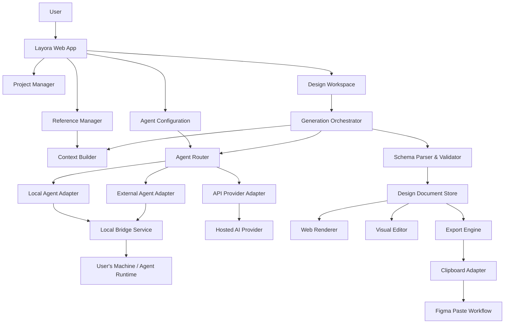
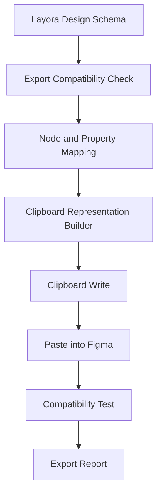

# Layora — Architecture

> **Product:** Layora  
> **Category:** AI-powered design workspace  
> **Positioning:** Transform ideas, visual references, and existing source code into structured UI designs that can be previewed, edited, and transferred to Figma.  
> **Document status:** Initial product architecture  
> **Version:** 0.1

---

## 1. Product Overview

Layora is a standalone web application for generating and editing interface designs with the help of AI agents. It supports three AI execution approaches:

1. **Local AI** — a model or agent running on the user's machine.
2. **API AI** — a hosted model accessed through a provider API.
3. **External AI Agent** — an existing coding agent or agent application, such as Codex, Claude Code, or Antigravity, connected through a supported local integration.

Layora supports two primary design workflows:

- **Create from Scratch:** Generate a new interface from a prompt and optional references.
- **Source Code to Design:** Inspect an existing website or source-code project and reconstruct its interface as a structured design.

The central technical principle is that AI output is not treated as final HTML or an image. The canonical output is a validated, versioned **Layora Design Schema**: a structured tree of design nodes. The same schema powers the browser renderer, visual editor, design history, and export adapters.

### 1.1 Product boundaries

Layora is a standalone web application. It does not require a Figma plugin as part of its intended user workflow and does not depend on writing directly to a Figma file through the Figma REST API.

The product's intended handoff is:

1. Generate and edit a design in Layora.
2. Convert the design tree into a Figma-compatible clipboard representation.
3. Copy that representation to the system clipboard.
4. Paste it into Figma.
5. Continue editing the resulting layers in Figma.

**Important feasibility constraint:** Figma's clipboard behavior and supported paste formats are not a general public import API. A JSON object that resembles Figma nodes cannot simply be placed on the clipboard and expected to become native Figma layers. Clipboard export must be proven experimentally. SVG paste can create editable vector objects but does not guarantee native text, Auto Layout, or semantic component structure. The project must not promise complete native editability until a tested clipboard implementation demonstrates it.

A Figma companion plugin may be evaluated as a fallback or optional future integration, but it is outside the initial product requirement.

---

## 2. Architectural Principles

1. **Schema-first:** The design tree is the source of truth. DOM elements are a rendering of the schema, not the canonical design data.
2. **Provider-agnostic:** Generation logic must not depend on one model vendor.
3. **Agent-agnostic:** External agents are connected through adapters with explicit capabilities.
4. **Reference-driven:** Prompts, screenshots, URLs, source code, and design-system inputs are explicit project context.
5. **Deterministic rendering:** Given the same schema, renderer version, fonts, and assets, the preview should be reproducible.
6. **Validated AI output:** Model output is untrusted input. Parse, validate, normalize, and repair it before rendering or exporting.
7. **Incremental generation:** Prefer generating and revising selected pages or node subtrees instead of regenerating an entire project for every change.
8. **No hidden execution:** Local agents and source-code analysis require explicit user permission and visible execution status.
9. **Graceful degradation:** Unsupported node properties must be reported and handled predictably rather than silently discarded.
10. **Export honesty:** Show which properties and node types are preserved by each export method.

---

## 3. High-Level System Architecture



### 3.1 Main layers

| Layer | Responsibility |
|---|---|
| Web application | Project navigation, setup, workspace, settings, and user interactions |
| Generation orchestrator | Builds task context, selects an agent, tracks generation, and manages revisions |
| Agent adapters | Normalize communication with local, API, and external agents |
| Local bridge | Provides a controlled communication channel to local processes |
| Design schema core | Defines node types, validation, normalization, migrations, and document operations |
| Renderer | Converts schema nodes into browser-rendered interface elements |
| Editor | Applies user changes to the schema |
| Export engine | Converts the schema into clipboard or file-export representations |
| Persistence | Stores projects, design versions, references, and agent configuration metadata |

---

## 4. AI Execution Modes

### 4.1 Local AI

The user selects a locally available model or local agent runtime. A local bridge service exposes a restricted interface to Layora.

Possible integrations include:

- Ollama-compatible local model endpoints.
- A local agent process started by the user.
- A future adapter for other local inference runtimes.

The application must detect availability, validate the selected model, and display connection status. It must not assume that every local model supports tool calling, vision, structured output, or large context windows.

### 4.2 API AI

The user selects a provider and configures credentials. Provider credentials should be stored securely and never embedded in client-side source code or exposed in logs.

The provider adapter normalizes:

- Text generation.
- Vision input, when supported.
- Structured output or JSON-schema mode, when supported.
- Tool calling, when supported.
- Token and usage metadata, when available.
- Provider errors and rate limits.

Provider capabilities must be discovered or configured explicitly. Do not present unsupported capabilities as available.

### 4.3 External AI Agent

This mode uses an existing agent environment instead of creating a new model runtime inside Layora.

Possible connection strategies include:

- CLI invocation with a controlled working directory.
- MCP integration, if the agent supports it.
- A local HTTP or WebSocket bridge.
- A user-mediated prompt handoff when direct automation is unavailable.

Each agent adapter must declare its capabilities, connection requirements, supported inputs, output contract, and limitations.

**Do not assume that Codex, Antigravity, Claude Code, or other products expose identical APIs.** Each integration needs its own technical verification and adapter.

### 4.4 Agent capability model

Each adapter should expose a capability description similar to:

```json
{
  "id": "example-agent",
  "capabilities": {
    "textGeneration": true,
    "vision": false,
    "structuredOutput": true,
    "toolCalling": false,
    "localFileAccess": true,
    "projectAnalysis": true
  },
  "connection": {
    "kind": "local-bridge",
    "status": "disconnected"
  }
}
```

This is an application-level capability record, not a provider's native API format.

---

## 5. Local Bridge Architecture

The local bridge is a separately installed or locally launched service. The browser application communicates with it only after the user explicitly connects it.

Responsibilities:

- Discover or connect to supported local runtimes.
- Receive approved generation tasks.
- Execute supported agent commands.
- Stream task status and output.
- Restrict file access to user-approved project directories.
- Return structured results and diagnostics.
- Stop or cancel running tasks.

Security requirements:

- Bind to loopback by default; do not expose a local service to the public network by default.
- Authenticate browser-to-bridge sessions using short-lived pairing tokens.
- Validate `Origin` and use an explicit origin allowlist.
- Require explicit directory selection before reading source code.
- Reject path traversal and access outside approved directories.
- Never execute arbitrary shell commands supplied directly by model output.
- Use an allowlisted command and tool registry.
- Show the user which files will be read or modified before any write operation.
- Keep secrets out of task logs and model context unless strictly required.
- Provide a visible disconnect and task-cancel control.

A browser-only application cannot safely or consistently access arbitrary local folders or launch local processes by itself. The bridge is therefore required for local project analysis and local agent execution.

---

## 6. Design Generation Workflows

### 6.1 Create from Scratch

1. User creates a project.
2. User selects an AI execution mode and agent.
3. User selects **Create from Scratch**.
4. User enters the product description, target platform, viewport, and design constraints.
5. User optionally attaches visual, website, Figma, component, or brand references.
6. Context Builder prepares a concise, traceable generation brief.
7. Agent generates a Layora Design Schema document.
8. Schema Parser validates and normalizes the result.
9. Renderer displays the generated design.
10. User revises the design through the editor or AI chat.
11. User copies or exports the design.

### 6.2 Source Code to Design

1. User creates a project and selects **Source Code to Design**.
2. User supplies a local directory, ZIP archive, Git repository, or accessible website URL.
3. Layora inspects the permitted source and identifies the relevant framework, routes, components, styles, assets, and dependencies.
4. The analysis process builds a page inventory and resolves which pages should be reconstructed.
5. Where possible, the existing application is rendered in a controlled browser environment to capture actual visual output.
6. The agent maps visual regions and source components into Layora Design Schema nodes.
7. Validator checks node structure, references, assets, and layout constraints.
8. Renderer displays the reconstructed interface.
9. User reviews differences and requests corrections.
10. User exports the result.

Source code alone may not fully describe the rendered appearance. Runtime state, API data, authentication, viewport, fonts, browser behavior, and dynamic content can affect the final UI. The workflow should request or capture a running preview when visual fidelity matters.

### 6.3 Reference handling

Reference types:

- Image or screenshot.
- Website URL.
- Existing design file or exported design material.
- Component reference.
- Brand assets and guidelines.
- Source-code files.

Each reference should store:

- Reference ID.
- Type.
- Display name.
- Source or file metadata.
- User notes.
- Page or region selection, where applicable.
- Extraction status.
- Related generation tasks.

References are context, not instructions. The agent must distinguish between a visual reference to learn from and content that should be reproduced literally.

---

## 7. Layora Design Schema

The schema is the canonical representation of a design document.

### 7.1 Document structure

```json
{
  "schemaVersion": "1.0.0",
  "document": {
    "id": "doc_dashboard",
    "name": "Dashboard",
    "viewport": {
      "width": 1440,
      "height": 1024
    },
    "children": []
  }
}
```

### 7.2 Initial node types

| Node type | Purpose |
|---|---|
| FRAME | Container, page, section, or card |
| TEXT | Text content and typography |
| RECTANGLE | Filled or bordered geometric shape |
| ELLIPSE | Circular or elliptical shape |
| IMAGE | Raster or remote image asset |
| VECTOR | SVG or vector path representation |
| COMPONENT_INSTANCE | Reusable component reference |
| GROUP | Logical grouping without layout behavior |

The initial implementation should prioritize FRAME, TEXT, RECTANGLE, IMAGE, and GROUP. More advanced types can be added after renderer and export behavior are verified.

### 7.3 Layout model

Support a normalized layout model independent of any specific renderer:

- `NONE`
- `VERTICAL`
- `HORIZONTAL`

Layout properties should include:

- Main-axis alignment.
- Cross-axis alignment.
- Gap.
- Padding.
- Width and height sizing modes.
- Child sizing behavior.
- Wrapping, where supported.
- Positioning mode.
- Clipping and overflow.

Do not assume every browser CSS feature maps cleanly to Figma Auto Layout. Unsupported behavior should be represented explicitly or approximated with documented limitations.

### 7.4 Styling model

Use explicit, serializable values for:

- Fill.
- Stroke.
- Corner radius.
- Opacity.
- Typography.
- Shadows.
- Effects.
- Image fit.
- Visibility.

Colors should use a consistent representation. If normalized RGB values are used, validate each channel and alpha within the range 0–1.

### 7.5 Schema validation

Validation must cover:

- Supported node types.
- Required fields per node type.
- Unique node IDs within a document.
- Valid parent-child relationships.
- Numeric ranges and dimensions.
- Valid colors and typography values.
- Asset references.
- Maximum tree depth and node count.
- Unsupported or unknown properties.

Invalid model output must never be passed directly into the renderer or exporter.

### 7.6 Schema evolution

Every document must contain a schema version. Migrations should convert older documents into the current version without silently dropping user data.

---

## 8. Rendering and Editing

### 8.1 Renderer

The browser renderer maps the schema into DOM elements and CSS. It should support:

- Consistent box sizing.
- Flex-based vertical and horizontal layout.
- Text rendering and wrapping.
- Images and image-fit behavior.
- Fills, borders, radii, and shadows.
- Fixed and content-based sizing.
- Clipping and visibility.
- Viewport presets.

The renderer must not mutate the canonical document during display.

### 8.2 Editor

The visual editor applies explicit operations to the document tree:

- Select node.
- Move node.
- Resize node.
- Change text.
- Change typography.
- Change fill and stroke.
- Change spacing and padding.
- Reorder children.
- Duplicate and delete.
- Group and ungroup.
- Undo and redo.

Use stable node IDs. Avoid identifying nodes by array index because reordering would make references unstable.

### 8.3 State management

Zustand may manage active project, selection, viewport, panel state, and editor interaction state.

The design document itself should use an operation-based update strategy or carefully normalized immutable state. Large design trees should not trigger unnecessary full-canvas rerenders.

---

## 9. Figma Clipboard Export

### 9.1 Export objective

The intended user experience is:

1. Click **Copy to Figma** in Layora.
2. Open a Figma design file.
3. Paste with `Ctrl + V` or `Cmd + V`.
4. Receive a design whose elements can be edited individually.

### 9.2 Export pipeline



### 9.3 Implementation constraints

The clipboard adapter must be based on verified Figma behavior, not on an assumed private format.

Possible approaches to investigate:

- HTML clipboard representations and Figma's paste handling.
- SVG clipboard representation for vector fallback.
- Existing open-source HTML-to-Figma conversion approaches, after checking maintenance, licensing, and compatibility.
- Optional companion integration as a future fallback if clipboard-only export cannot meet the required editability.

The implementation must test the actual paste result in Figma. It must not claim that a design is native Auto Layout merely because the internal schema contains a `layoutMode` property.

### 9.4 Export compatibility report

Before copying, report:

- Supported nodes.
- Unsupported nodes.
- Properties that will be preserved.
- Properties that will be approximated.
- Whether text remains editable.
- Whether layout behavior is preserved.
- Whether assets are embedded or linked.

### 9.5 Proof of concept acceptance criteria

Clipboard export is considered viable only after testing a representative document containing:

- Nested frames.
- Vertical and horizontal layouts.
- Text with different font sizes and weights.
- Rectangles and fills.
- Rounded corners.
- Images.
- Multiple levels of hierarchy.

The pasted result must be inspected in Figma for editability, layer hierarchy, text behavior, sizing, and visual fidelity. Test results should be recorded per node type and property.

---

## 10. Persistence and Project Data

Initial persistence entities:

- User settings.
- Project.
- Design document.
- Design version.
- Reference.
- Agent configuration metadata.
- Generation task.
- Export history.

Do not store raw API secrets in ordinary project JSON. Use secure credential storage appropriate to the deployment model.

For a local-first MVP, IndexedDB can store project documents, references, and local metadata. A backend can be added later for account sync, collaboration, and remote storage.

---

## 11. Error Handling and Observability

Every generation task should have a lifecycle:

- Pending.
- Preparing context.
- Connecting to agent.
- Generating.
- Validating.
- Rendering.
- Completed.
- Failed.
- Cancelled.

Errors should identify the failing stage and provide a useful recovery action.

Log operational metadata, not sensitive prompt content or source files by default. Allow users to inspect task diagnostics and control what is retained.

---

## 12. Non-Functional Requirements

- **Reliability:** Invalid AI output must not crash the editor.
- **Performance:** Editing one node should not require regenerating the entire document.
- **Security:** Local file access and command execution must be explicitly permissioned.
- **Portability:** Design documents should be serializable and exportable.
- **Accessibility:** Workspace controls and generated previews should support keyboard navigation and accessible labels where applicable.
- **Maintainability:** Provider, agent, renderer, and exporter integrations must be isolated behind adapters.
- **Traceability:** Generated nodes and revisions should be attributable to a task or user edit when practical.

---

## 13. Recommended MVP Scope

### Include

1. Project creation and management.
2. Local/API agent configuration with a small number of verified adapters.
3. Create from Scratch workflow.
4. Basic image and text references.
5. Layora Design Schema v1.
6. Schema validation.
7. DOM-based renderer.
8. Basic visual editing.
9. Design version history.
10. Clipboard export proof of concept and compatibility report.

### Defer

- Full support for every external agent.
- Advanced component variants.
- Multi-user collaboration.
- Full design-system publishing.
- Complete responsive breakpoint authoring.
- Broad source-code framework coverage.
- Guaranteed native Figma Auto Layout through clipboard.
- Direct Figma file write integration.

Source Code to Design should follow once the schema, renderer, and export proof of concept are stable.

---

## 14. Architecture Decision Records

| Decision | Initial direction | Reason |
|---|---|---|
| Canonical design format | Layora Design Schema | Independent of renderer and AI provider |
| Web rendering | DOM and CSS | Strong typography and layout support |
| State management | Zustand | Lightweight workspace state |
| Schema validation | Zod | Runtime validation and TypeScript inference |
| AI integration | Adapter pattern | Provider and agent independence |
| Local execution | Local bridge | Controlled access to local runtimes and files |
| Export | Clipboard adapter | Matches desired user workflow |
| Figma plugin | Not required for MVP | Standalone product requirement |

---

## 15. Definition of Architectural Success

The architecture is successful when:

1. Different AI execution modes can produce the same schema.
2. The same schema renders consistently in the web workspace.
3. Manual edits update the canonical schema.
4. Design versions can be restored.
5. Export compatibility is measurable and transparent.
6. The clipboard proof of concept produces individually editable Figma elements for the supported subset.
7. No unsupported export capability is presented as guaranteed.
